

# Kenshin Meibo

The dojo register for **Kenshin Karate Langwarrin**: student check-in on the touch screen, student records, gradings, the timetable, reports and backups.

**[Download the latest version](https://github.com/DonCorleon/kenshin-meibo-releases/releases/latest)** (Windows, currently 0.3.0). New versions also install themselves from inside the program: see [Updates](#updates).

This page holds the downloads and the help. Every picture uses made-up students. The same help is inside the program under **Help**.

## Contents

**Getting started**

- [Set up Kenshin Meibo on a PC](#set-up-kenshin-meibo-on-a-pc): Download, unzip, and the first-time setup. No installer and no admin password needed.
- [Start Kenshin Meibo each day](#start-kenshin-meibo-each-day): Double-click, log in, and check-in opens by itself.
- [The icon by the clock](#the-icon-by-the-clock): Closed a window by mistake? This is how you get it back.
- [Finding help](#finding-help): Search these pages from Help in the menu.

**Check-in**

- [How students check in](#how-students-check-in): Choose the class, type the number, Bow in.
- [When check-in says no](#when-check-in-says-no): What each message on the touch screen means and what to do.

**Today**

- [See who's in today](#see-whos-in-today): The main screen shows every class on today and who's checked in.
- [Check someone in at the desk](#check-someone-in-at-the-desk): For anyone who didn't use the touch screen.
- [Fix a wrong check-in](#fix-a-wrong-check-in): Someone checked into the wrong class? Take them out.

**Students**

- [Find a student](#find-a-student): Search by name, number or phone, and narrow the list.
- [Add a new student](#add-a-new-student): One page. Only first name and surname are required.
- [Change a student's details or photo](#change-a-students-details-or-photo): Open the student, change what you need, save.
- [Notes about a student](#notes-about-a-student): A dated list of notes on each student, newest first, with who wrote each one.
- [Medical details](#medical-details): Allergies, conditions and medications, and where they show up.
- [Parents, emergency contacts and families](#parents-emergency-contacts-and-families): Who to call, and linking brothers and sisters so they check in together.
- [Change several students at once](#change-several-students-at-once): Tick students on the list, then print them, add them to a grading, move group or mark as left.
- [When a student leaves](#when-a-student-leaves): Mark them as not enrolled. Their history is kept in case they come back.
- [Attendance and history](#attendance-and-history): Classes attended, month by month, and what the old program had.

**Gradings**

- [Grading day](#grading-day): One sheet for the whole day. One click per student, and ranks update themselves.
- [One student's grading](#one-students-grading): Record a grading for one student, or remove one recorded by mistake.

**Timetable**

- [The weekly timetable](#the-weekly-timetable): The regular classes each week. These are what students choose from on check-in.
- [Cancel a class or add a one-off](#cancel-a-class-or-add-a-one-off): Changes for a single date. The weekly timetable stays the same.
- [Holidays and closures](#holidays-and-closures): Close the dojo for a day or a stretch of days.

**Reports**

- [Print a list or save it to Excel](#print-a-list-or-save-it-to-excel): Eight ready-made lists that print on A4 or open in Excel.

**Settings**

- [Logins and passwords](#logins-and-passwords): Give each person their own login, change your password, remove a login.
- [Forgotten password](#forgotten-password): Use another login, the printed recovery code, or call Don.
- [Backups](#backups): Where backups go, how often, and what the warnings mean.
- [Back up to a USB stick](#back-up-to-a-usb-stick): Set the stick up once. After that, plugging it in asks to back up.
- [Get data back from a backup](#get-data-back-from-a-backup): Put an earlier backup back, from Settings → Backups. It can be undone.
- [Choose which screen does what](#choose-which-screen-does-what): Which monitor shows the main screen and which shows check-in.
- [Updates](#updates): New versions show up by themselves and install with one click.
- [Moving to a new PC](#moving-to-a-new-pc): Copy one folder, log in. Nothing is tied to the old PC.

**Questions and answers**

- [Questions and answers](#questions-and-answers): Quick answers to common questions, with links to the full how-to.

---

## Getting started

### Set up Kenshin Meibo on a PC

Kenshin Meibo doesn't need installing. It's a folder you unzip and run.

### 1. Download it

1. Go to **github.com/DonCorleon/kenshin-meibo-releases** and click the newest release on the right.
2. Under **Assets**, click the file named like `Kenshin-Meibo-0.2.0-windows.zip`.

### 2. Unzip it somewhere that's yours

1. Right-click the downloaded zip and choose **Extract All…**.
2. Pick a folder such as `C:\Kenshin Meibo` or your Documents folder.

Avoid `C:\Program Files`, because Windows won't let the program save its data there.

### 3. Start it

Open the folder and double-click **KenshinMeibo.exe**. Right-click it and choose **Send to → Desktop (create shortcut)** for an icon on the desktop.

The first time, Windows may show **"Windows protected your PC"**. Click **More info**, then **Run anyway**. Windows only asks once.

### 4. First-time setup

The first screen asks how to start:

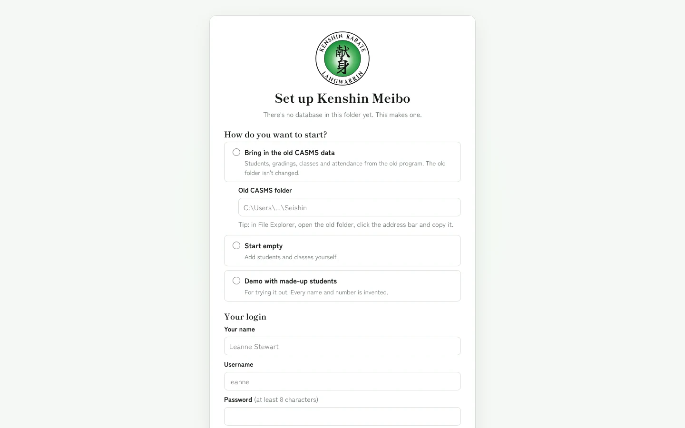

- **Bring in the old CASMS data**: point it at the old CASMS folder. Every student keeps their number, and nothing is left behind.
- **Start empty**: an empty register.
- **Bring back a Kenshin Meibo backup**: for a new PC. See [Moving to a new PC](#moving-to-a-new-pc).
- **Demo with made-up students**: for trying things out.

Then enter **your name**, a **username** and a **password** of at least 8 characters. This becomes the first login.

### 5. Write down the recovery code

Next you'll see a **recovery code**. It's shown only once. Print it or write it down, and keep it away from the computer. If every password is forgotten, the code is how you get back in. See [Forgotten password](#forgotten-password).

### 6. Choose the screens and where backups go

Kenshin Meibo then asks which monitor is which. See [Choose which screen does what](#choose-which-screen-does-what). After that it asks where to keep backups. See [Backups](#backups).

[↑ Contents](#contents)

### Start Kenshin Meibo each day

### Starting

Double-click **Kenshin Meibo** on the desktop. Two windows open:

- On the **main screen**, the login page.
- On the **touch screen**, check-in, showing "closed" until someone logs in.

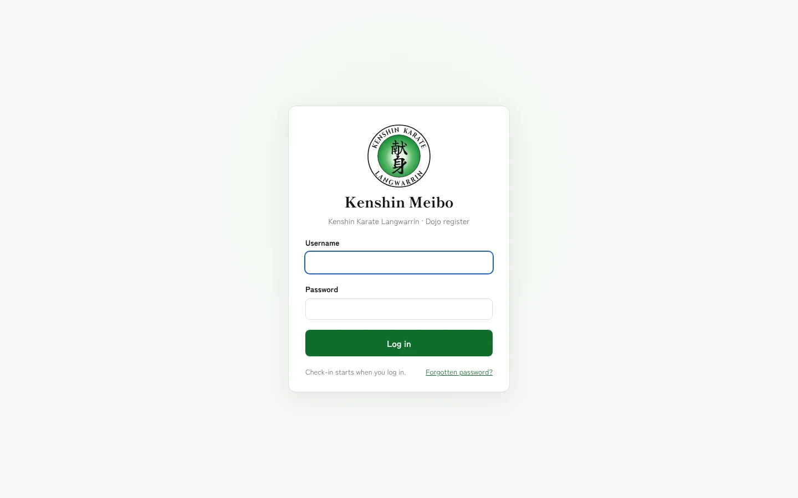

Log in with your own username and password. Check-in opens by itself on the touch screen, and the main screen shows [Today](#see-whos-in-today).

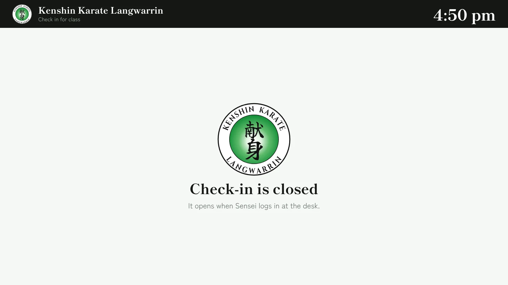

### Why log in every time?

All the student details, including medical information, are locked in an encrypted file. Logging in is what unlocks them. If someone copied the folder or took the PC, they couldn't read anything without a password.

### Finishing up

The buttons at the bottom left of the main screen:

| Button | What it does |
|---|---|
| **Log out** | Logs *you* out. Check-in keeps working for whoever's next. |
| **Lock and stop check-in** | Locks everything. Check-in shows "closed" until someone logs in again. |

To close the program completely, right-click the [icon by the clock](#the-icon-by-the-clock) and choose **Quit Kenshin Meibo**. Shutting the PC down is fine too. Either way, it backs up first if that's turned on.

[↑ Contents](#contents)

### The icon by the clock

While Kenshin Meibo is running, its logo sits in the bottom-right corner of the screen, next to the clock.

**Closing a window doesn't stop the program.** Check-in keeps working. To get a window back, use the icon.

### Getting a window back

- **Click** the icon to bring back the main (admin) screen.
- **Right-click** it for more:

| Menu item | What it does |
|---|---|
| **Show admin screen** | Brings the main screen to the front, or reopens it. |
| **Show check-in screen** | The same for the touch screen. |
| **Back up now** | Makes a backup straight away. |
| **Lock and stop check-in** | Locks the data; check-in shows "closed". |
| **Install update…** | Only appears when a new version is ready. See [Updates](#updates). |
| **Open the program folder** | Opens the Kenshin Meibo folder, which is handy if Don asks for the logs. |
| **Quit Kenshin Meibo** | Closes everything. It asks first. |

Double-clicking **Kenshin Meibo** on the desktop again does the same as **Show admin screen**.

### I can't see the icon

Windows often hides new icons. Click the small **^** arrow by the clock, and it'll be in there. Drag it out onto the taskbar so it's always visible.

A reopened admin screen starts at the login page. Log in again; check-in hasn't stopped.

[↑ Contents](#contents)

### Finding help

Click **Help** in the menu on the left. Type what you want to do, like *add a student*, *holiday* or *password*, and the list narrows as you type.

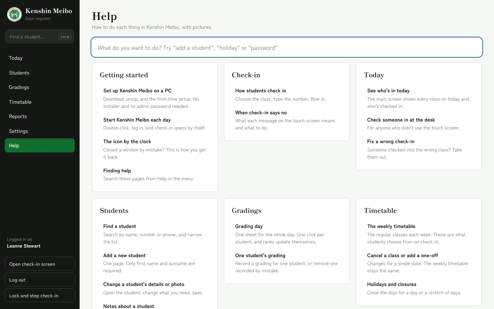

The same pages, with the same pictures, are on the Kenshin Meibo download page. You can read them on a phone or another computer too.

If something isn't covered here or doesn't work the way it says, let Don know. Help gets updated with each new version.

[↑ Contents](#contents)

---

## Check-in

### How students check in

The touch screen is for students. It shows names and ranks only. Medical details, addresses and phone numbers never appear on it.

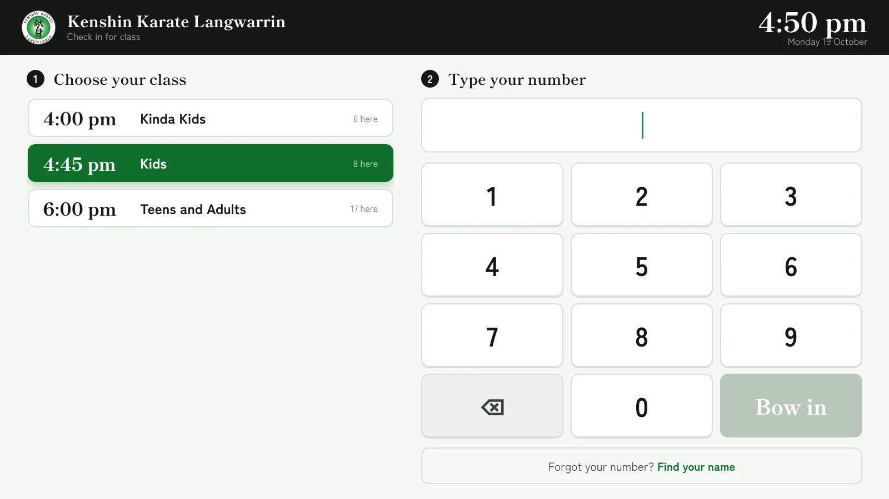

### The usual way

1. **Choose your class** on the left. The class on now is already chosen.
2. **Type your number** on the keypad.
3. Tap **Bow in**.

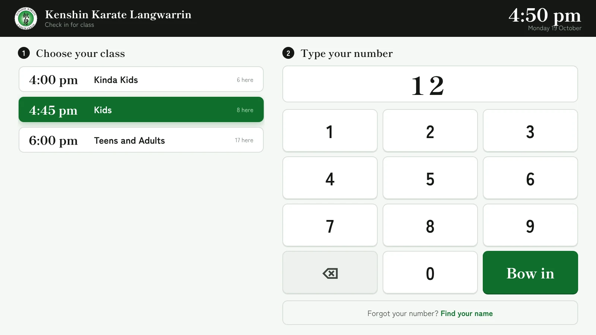

The student sees their name, class and rank, and how many classes they've done since their last grading:

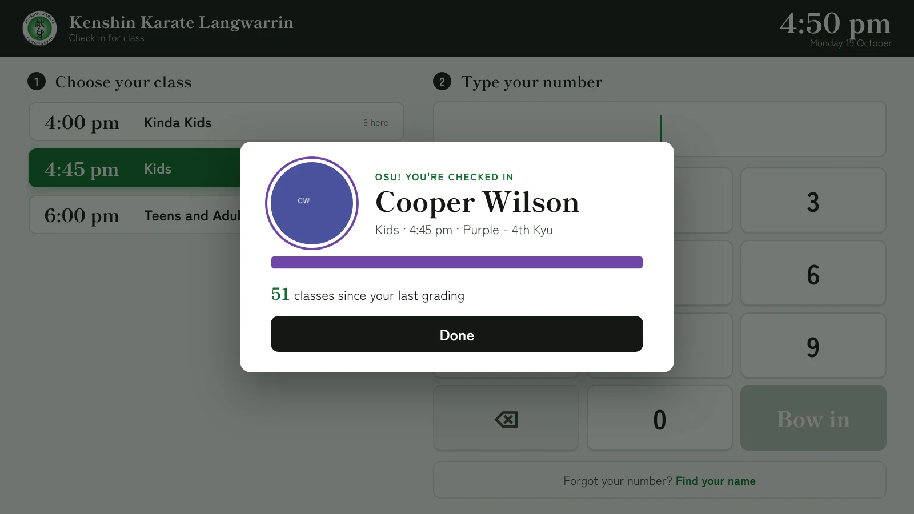

After a few seconds it goes back to the keypad for the next person. Tap **Done** to skip the wait.

### Brothers and sisters

If the student has brothers or sisters linked to them (see [Families](#parents-emergency-contacts-and-families)), their names appear under **"Checking in with you? Tap their name"**. Tap each one who's at class. One number checks in the whole family.

### Forgot your number?

Tap **Forgot your number? Find your name**, type the first few letters of your name, then tap it.

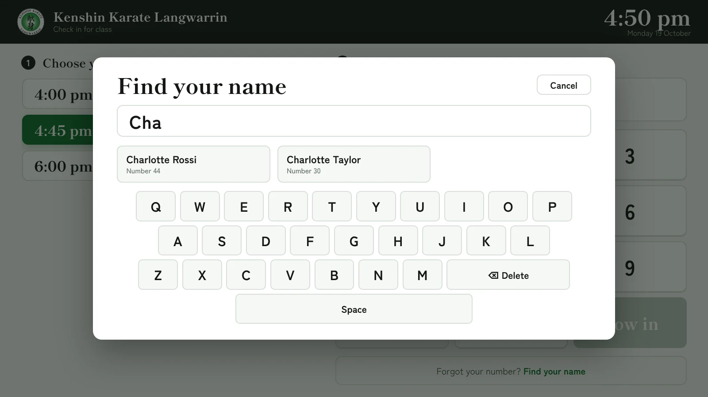

### Good to know

- Checking in twice for the same class is harmless. It just says "You're already checked in".
- A half-typed number clears itself after 30 seconds.
- Students marked as not enrolled are still checked in, but are asked to see Sensei before class.
- If someone checks into the wrong class, fix it from the main screen. See [Fix a wrong check-in](#fix-a-wrong-check-in).

[↑ Contents](#contents)

### When check-in says no

| The screen says | Why | What to do |
|---|---|---|
| **Check-in is closed** | Nobody's logged in on the main screen, or it's been locked. | Log in on the main screen. Check-in opens by itself. |
| **We can't find number …** | No student has that number. | Check the number, or use **Find your name**. New students need [adding](#add-a-new-student) first. |
| **That class isn't on now** | The chosen class has finished or been cancelled. | Choose another class. |
| **Please see Sensei at the desk** | The student is marked as not enrolled. They're still checked in. | Have a chat, and tick **Currently enrolled** on their record if they're back. |
| **Closed today** | The day is marked as a holiday or closure. | Check [Holidays and closures](#holidays-and-closures). |

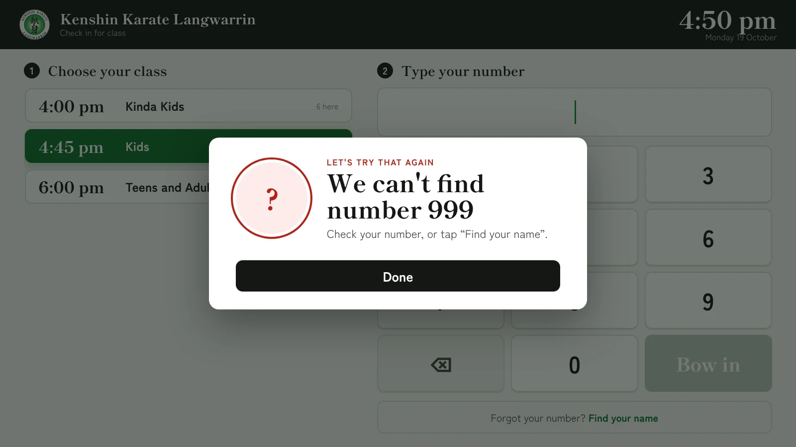

### The touch screen is blank, or showing the wrong thing

Right-click the [icon by the clock](#the-icon-by-the-clock) and choose **Show check-in screen**. If it opens on the wrong monitor, see [Choose which screen does what](#choose-which-screen-does-what).

[↑ Contents](#contents)

---

## Today

### See who's in today

**Today** is the first page after logging in. It shows each of today's classes with everyone checked in, newest last. It updates by itself every few seconds.

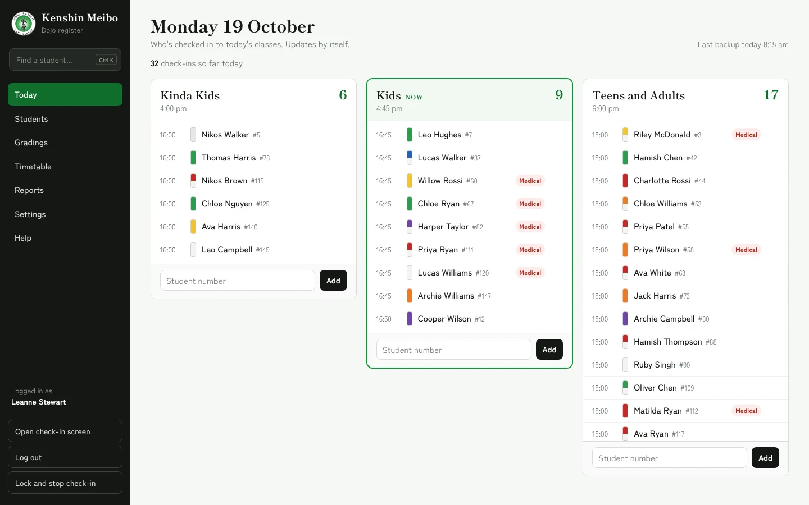

- The class that's on now is outlined in green and marked **Now**.
- The number at the top right of each class is how many are in.
- Each student shows their check-in time, belt colours, name and number.
- A red **Medical** tag means they have allergies, conditions or medications on file. Open their record to read it.
- **Inactive** means they're marked as not enrolled. **Desk** means they were added at the desk rather than on the touch screen.

On a wide screen, a busy class splits into columns so it fits without scrolling.

At the top right, **Last backup …** shows when the last backup was made. Click it to go to the backup settings.

[↑ Contents](#contents)

### Check someone in at the desk

At the bottom of each class on [Today](#see-whos-in-today) is a **Student number** box.

1. Type the student's number in the box under the right class.
2. Click **Add**.

They appear in that class with a **Desk** tag. If the number isn't found, it says so under the box.

Don't know their number? Find them in [Students](#find-a-student). It's next to their name.

[↑ Contents](#contents)

### Fix a wrong check-in

1. On [Today](#see-whos-in-today), move the mouse over the student's name. A small **×** appears at the end of the line.
2. Click the **×**, then **OK** to confirm.

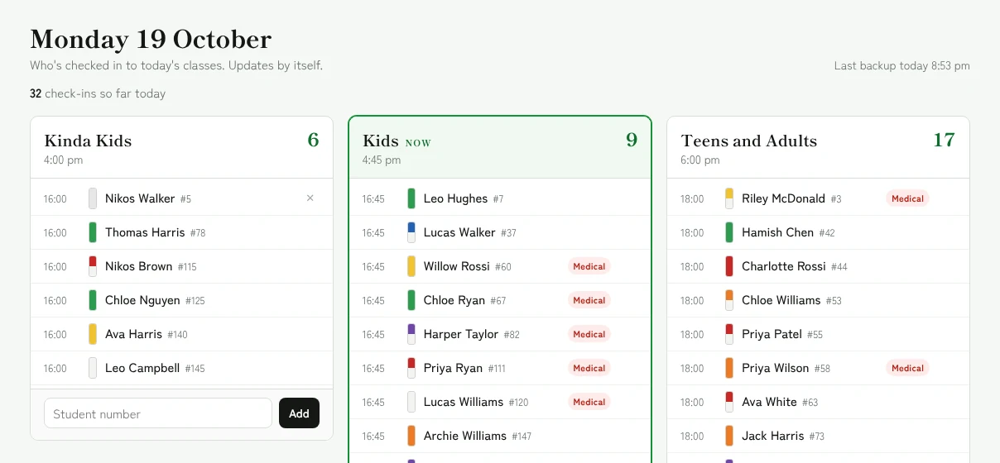

They're taken out of that class. If they belong in another class, [add them there](#check-someone-in-at-the-desk) or have them check in again on the touch screen.

The change is recorded in the change log, so it's always clear who changed what.

[↑ Contents](#contents)

---

## Students

### Find a student

### From any page: quick find

The **Find a student…** box at the top of the menu works on every page. Click it, or press **Ctrl+K**, and start typing a name, a student number or a phone number.

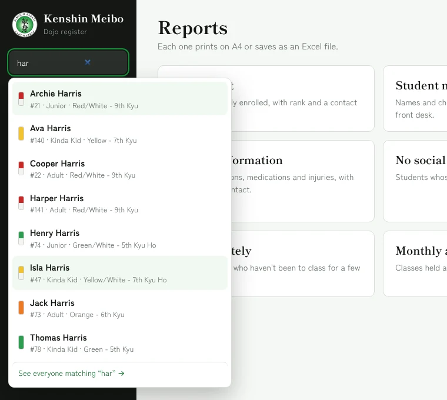

- Click a student to open them, or use the arrow keys and press **Enter**.
- Type a number and press **Enter** to go straight to that student.
- Press **Esc** to close it.

Current students are listed before students who've left.

### The student list

Click **Students** in the menu.

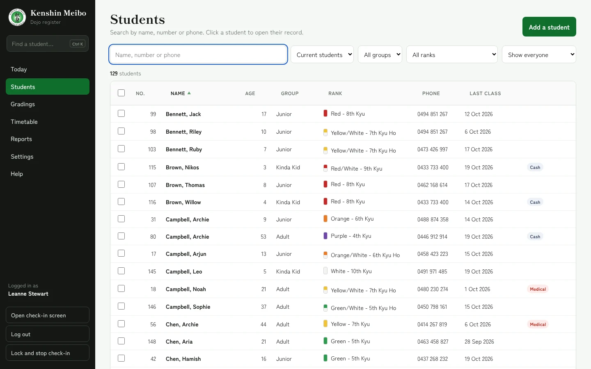

- Type in the search box: part of a name, a student number or a phone number. The list updates as you type.
- Use the drop-downs to narrow it:
  - **Current students / Inactive / Everyone**
  - a group: Kinda Kids, Juniors, Adults
  - a rank
  - **Has medical info**, **No social media**, **Pays cash** or **No emergency phone**
- Click anyone to open their record.

### Sorting

Click a column heading to sort by it, for example **Age** or **Rank**. Click it again to reverse the order. A small arrow shows which column is sorted and which way:

- ▲ means lowest first: A to Z, youngest first, White belt first, oldest date first.
- ▼ means the other way round.

Sorting goes by meaning, not by the letters. **Rank** follows the belt order, and **Age** goes by date of birth. Students with nothing in that column (no phone, never been to class) always go to the bottom.

The order is kept while you work: open a student, go back, and the list is how you left it. It works together with the search and the filters, for example Juniors sorted by rank.

The count above the list shows how many match. To print a list, use [Reports](#print-a-list-or-save-it-to-excel).

[↑ Contents](#contents)

### Add a new student

1. Click **Students**, then **Add a student** at the top right.
2. Fill in what you know. Only **First name** and **Surname** are required.
3. Click **Add student**.

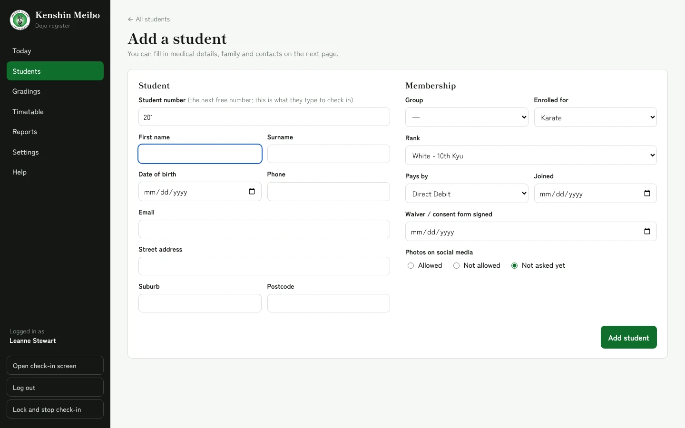

### Good to know

- **Student number** is filled in with the next free number. That's what they type to check in, so tell them. You can change it if you prefer, as long as nobody else has it.
- New students start on **White** and **Direct Debit**. Change either if needed.
- **Waiver / consent form signed** and **Photos on social media** are asked here so they don't get forgotten. Leave media as *Not asked yet* until you know.

### "Already here?"

When you type a name, date of birth or phone, Kenshin Meibo checks whether that student might already be in the register. That's common with students coming back after a break. Matches show under the phone box straight away. If you still click **Add student**, it stops and asks:

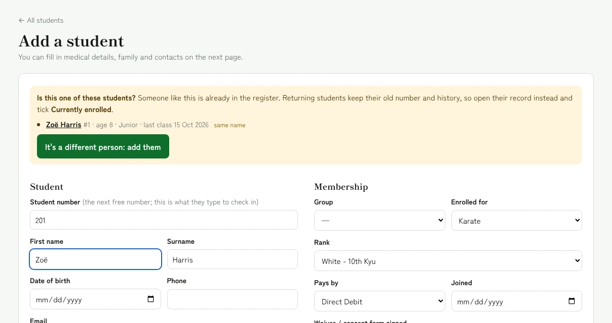

- **If it's them**, click their name. Open their record and tick **Currently enrolled**: they keep their old number, rank and history.
- **If it's someone else**, for example two kids with the same name, click **It's a different person: add them**.

It matches on the same name, the same surname or first name with the same date of birth, or the same first name and phone, and it includes students who have left. If something you typed is wrong, like a number already in use, the form keeps everything you typed.

After adding, you land on their record. From there, add:

- [medical details](#medical-details)
- [parents and emergency contacts](#parents-emergency-contacts-and-families)
- [a photo](#change-a-students-details-or-photo)
- [link them to a brother or sister](#parents-emergency-contacts-and-families)

[↑ Contents](#contents)

### Change a student's details or photo

1. Find the student in [Students](#find-a-student) and click their name.
2. The **Details** tab opens.

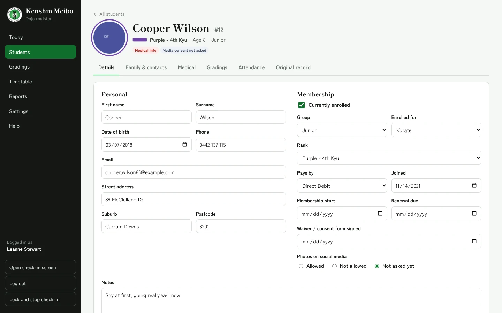

3. Change anything you need, such as phone, address, group, rank, how they pay or membership dates.
4. Click **Save details**.

The tabs along the top hold everything else:

| Tab | What's there |
|---|---|
| **Details** | Name, contact, membership, rank, [notes](#notes-about-a-student), photo |
| **Family & contacts** | Parents and guardians, emergency contacts, brothers and sisters. See [Families](#parents-emergency-contacts-and-families). |
| **Medical** | Allergies, conditions, medications. See [Medical details](#medical-details). |
| **Gradings** | Every grading. See [One student's grading](#one-students-grading). |
| **Attendance** | Classes attended. See [Attendance and history](#attendance-and-history). |
| **Original record** | What the old program had |

### Photo

Under **Photo** on the Details tab:

- Click **Choose file**, pick the picture, then **Add photo**.
- To change it, use **Replace photo**. To take it off, use **Remove**.

The photo shows on the check-in screen when they bow in. Like everything else, it's stored inside the encrypted data, not as a loose file.

### Rank

You can change the rank here, but after a grading it's quicker to use [Grading day](#grading-day), which records it in their history as well.

[↑ Contents](#contents)

### Notes about a student

Open the student. **Notes** is on the **Details** tab, below the details.

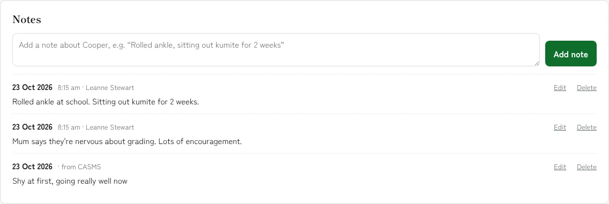

### Add a note

Type it in the box and click **Add note**. It's saved with today's date and your name, at the top of the list. Notes build up over time, so you can see what's happened and when, for example an injury, a chat with a parent, or something to work on.

### Change or delete a note

- **Edit** opens the note for changing. Click **Save changes**, then **OK**. The note then shows when it was edited and by whom.
- **Delete** removes the note after you click **OK**. It can't be undone.

### Good to know

- Notes that were in the old program, or in the earlier single notes box, are kept as the first note. They show "from CASMS" or "from the old notes box".
- Notes never show on the check-in screen.
- The change log records that a note was added, edited or deleted, but never what it says.

[↑ Contents](#contents)

### Medical details

1. Open the student and click the **Medical** tab.
2. Fill in **allergies**, **conditions** and **medications**, plus any notes for instructors.
3. Click **Save medical details**.

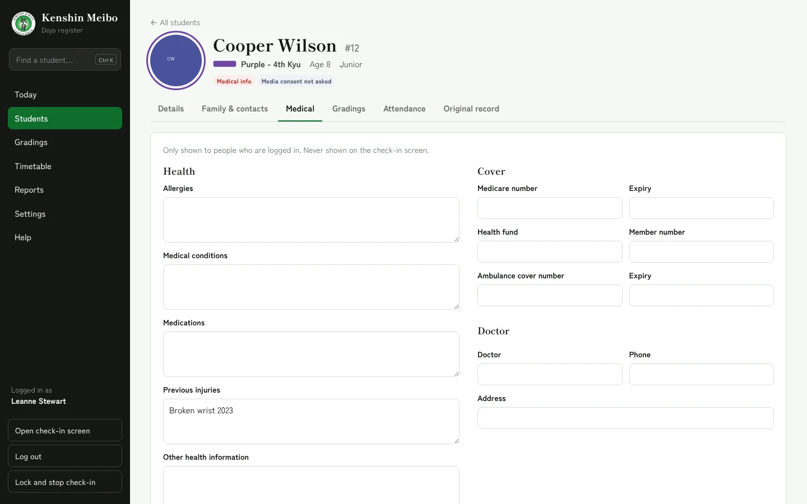

Anyone with something filled in gets a red **Medical** tag on [Today](#see-whos-in-today) and in the student list, so instructors notice.

To print everyone's medical details, with an emergency contact for each, use the **Medical information** [report](#print-a-list-or-save-it-to-excel). It's marked *Confidential* when printed.

Medical details never appear on the check-in screen. Changes are logged, but the log records *that* something changed, never *what*, so medical details don't end up in it.

[↑ Contents](#contents)

### Parents, emergency contacts and families

Open the student and click the **Family & contacts** tab.

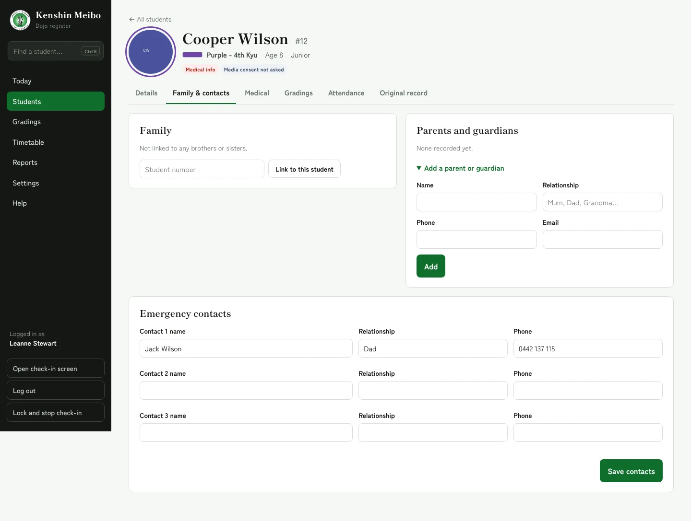

### Parents and guardians

Fill in the name, how they're related, phone and email, then click **Add**. Click **Remove** next to someone to take them off.

### Emergency contacts

Fill in the name and number, then click **Save contacts**. Students without an emergency phone show up in the **Emergency contacts** report and in the **No emergency phone** filter on the student list.

### Brothers and sisters

Linking students puts them in one family. Linked students:

- check in together: one number, then tap the others' names (see [How students check in](#how-students-check-in))
- share their parents and guardians

To link two students, type the other student's **number** under **Family** and click **Link**.

Under **Possible family**, Kenshin Meibo also lists students with the same surname and the same phone or address. Click **Link** next to the right one.

To unlink a student, click **Remove (name) from this family**. Nothing else about them changes.

[↑ Contents](#contents)

### Change several students at once

On the [student list](#find-a-student), tick the box at the start of each student you want. The box in the heading ticks everyone in the list as it's showing.

A dark bar appears at the top saying how many are ticked:

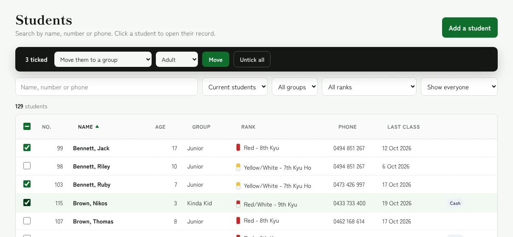

1. Choose what to do in the first box:
   - **Print a list of them**: opens a Student list of just those students, ready to print or save to Excel.
   - **Add them to a grading day**: choose the day, and they're added to its [grading sheet](#grading-day).
   - **Move them to a group**: choose Kinda Kid, Junior or Adult.
   - **Mark them as left**: see [When a student leaves](#when-a-student-leaves). Their history is kept.
   - **Mark them as current students**: for students coming back.
2. Click the button. Changes ask **"are you sure?"** first.

Ticks stay while you search or sort, so you can tick students from several searches, then act on them all together. **Untick all** clears them.

[↑ Contents](#contents)

### When a student leaves

Students aren't deleted. Their attendance and gradings are part of the dojo's records, and many come back.

1. Open the student. The **Details** tab opens.
2. Untick **Currently enrolled**.
3. Click **Save details**.

They disappear from the normal student list and from reports, but nothing is lost:

- To see them, choose **Inactive** or **Everyone** in the [student list](#find-a-student).
- If they come back, tick **Currently enrolled** again. Their number, rank and history are all still there.
- If they check in while not enrolled, they're let in but asked to see Sensei.

Their number is never given to anyone else.

If several students have left, tick them all on the student list and choose **Mark them as left**. See [Change several students at once](#change-several-students-at-once).

[↑ Contents](#contents)

### Attendance and history

### Attendance

The **Attendance** tab on a student shows:

- how many classes they've attended
- a bar for each month, so you can see if they're coming less often
- their most recent classes

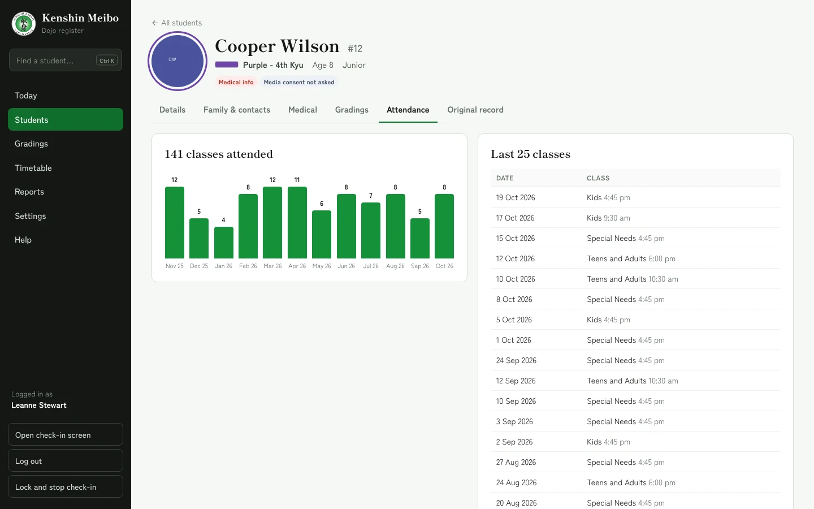

Every check-in from the old program came across, so the history goes back to when they started.

### Original record

The **Original record** tab shows exactly what the old CASMS program had for the student, read-only. It's there so nothing was lost in the move. You never need to change it.

For the whole dojo, see the **Monthly attendance** and **Not seen lately** [reports](#print-a-list-or-save-it-to-excel).

[↑ Contents](#contents)

---

## Gradings

### Grading day

### Before the day: make the sheet

1. Click **Gradings** in the menu.
2. Under **New grading day**, pick the date and give it a name if you like, such as *December grading*. Click **Create grading sheet**.

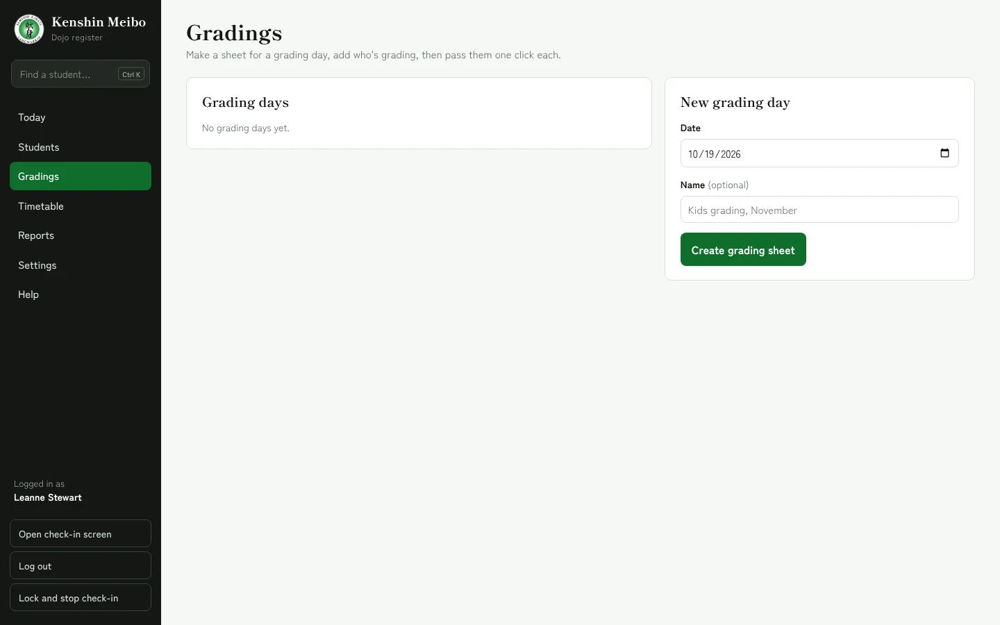

3. Under **Add students**, tick who's grading. Students are listed by **classes since their last grading**, most first, so the ones who are due are at the top. Use **All groups** to show just Kinda Kids, Juniors or Adults. The second box changes the order: **Name**, **Rank** or **Youngest first**.

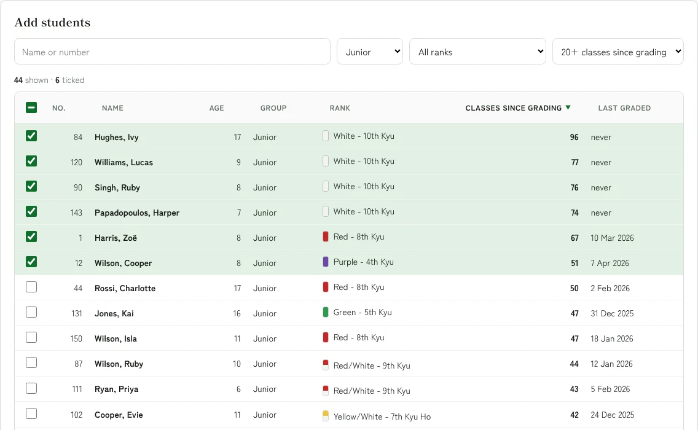

4. Click **Add ticked students to the sheet**.

### On the day: one click each

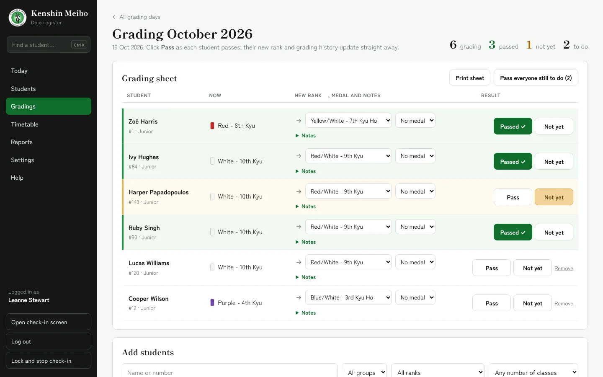

- Each student shows their current rank and the **new rank**. The next rank is already filled in; change it if someone skips a rank.
- Click **Pass** or **Not yet** for each student. Their rank changes there and then, and it's added to their history.
- **Medal** and **notes** are optional, for anyone who needs a comment.
- Click **Student**, **Now**, **New rank** or **Result** at the top of the sheet to sort it, for example by rank so each belt grades together. Click again to reverse.
- If everyone left has passed, click **Pass everyone still to do**.

### Made a mistake?

- Clicking **Passed** again undoes it. Their rank goes back and it comes out of their history.
- To take someone off the sheet, click **Remove** on their line. Remove only shows until they've been marked Pass or Not yet.

Passing resets the "classes since your last grading" count students see when they check in.

Every grading day stays on the **Gradings** page, with how many passed and how many didn't yet.

[↑ Contents](#contents)

### One student's grading

For a single student, for example someone grading on their own or a grading from another dojo:

1. Open the student and click the **Gradings** tab.
2. Under **Record a grading**, choose the date and the new rank. Add a result (Bronze, Silver or Gold) or notes if you like.
3. Leave **Make this their current rank** ticked, unless it's an old grading you're filling in.
4. Click **Save grading**.

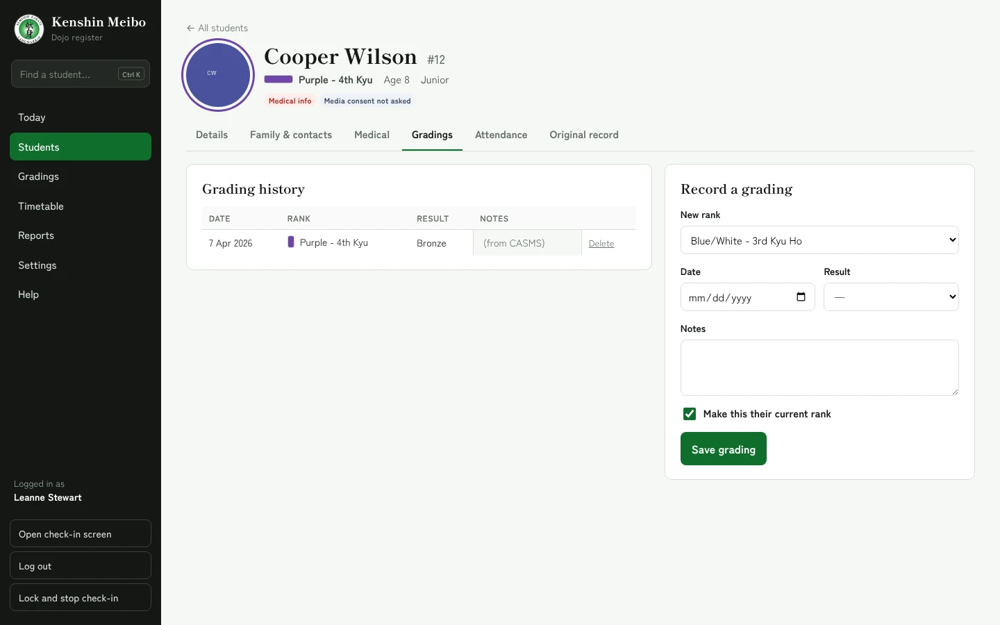

To remove a grading recorded by mistake, click **Delete** next to it in **Grading history**. Then check the rank on the Details tab is right.

[↑ Contents](#contents)

---

## Timetable

### The weekly timetable

Click **Timetable** in the menu. The top shows each day of the week and its classes.

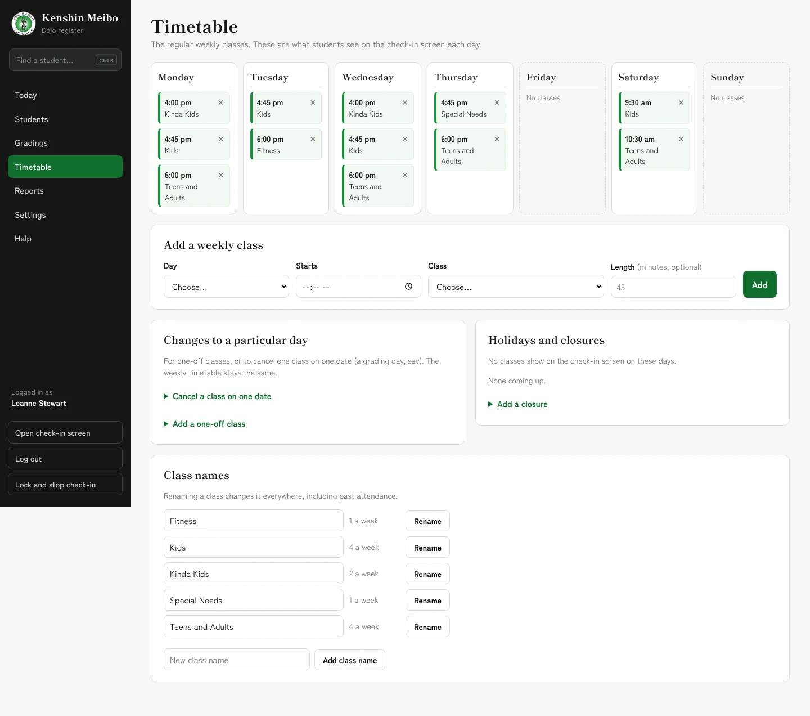

### Add a weekly class

Under **Add a weekly class**, choose the **Day**, the **Starts** time and the **Class**. **Length** is optional. Click **Add**.

### Take a class off the timetable

Click the **×** on the class in its day. Past attendance for that class is kept.

### Rename a class or add a new kind of class

Under **Class names**:

- change a name and click **Rename**. This changes it everywhere, including past attendance.
- type a new name in **New class name** and click **Add class name**. It can then be used in the timetable.

For one-off changes, such as a cancelled class or an extra class on one date, see [Cancel a class or add a one-off](#cancel-a-class-or-add-a-one-off). For holidays, see [Holidays and closures](#holidays-and-closures).

[↑ Contents](#contents)

### Cancel a class or add a one-off

On **Timetable**, under **Changes to a particular day**:

### Cancel one class on one date

1. Click **Cancel a class on one date**.
2. Choose the **Date** and the **Class**. Add a **Reason** if you like, such as *Sensei away*.
3. Click **Cancel that class**.

That class won't appear on the check-in screen that day.

### Add a one-off class

1. Click **Add a one-off class**.
2. Choose the **Date**, **Starts** time and **Class**. Add a **Note** if you like.
3. Click **Add class**.

It appears on check-in on that date only.

### Undo

Upcoming changes are listed in the same box. Click **Undo** next to one to reverse it.

[↑ Contents](#contents)

### Holidays and closures

On **Timetable**, under **Holidays and closures**:

1. Click **Add a closure**.
2. Choose the **First day** and **Last day**. For one day, use the same date for both.
3. Add a **Reason**, such as *Christmas break*. Students see it on the check-in screen.
4. Click **Add closure**.

On those days the check-in screen says **Closed today** with your reason, and Today shows the same.

Coming closures are listed in the box. Click **Remove** to reopen.

[↑ Contents](#contents)

---

## Reports

### Print a list or save it to Excel

Click **Reports** in the menu and pick one.

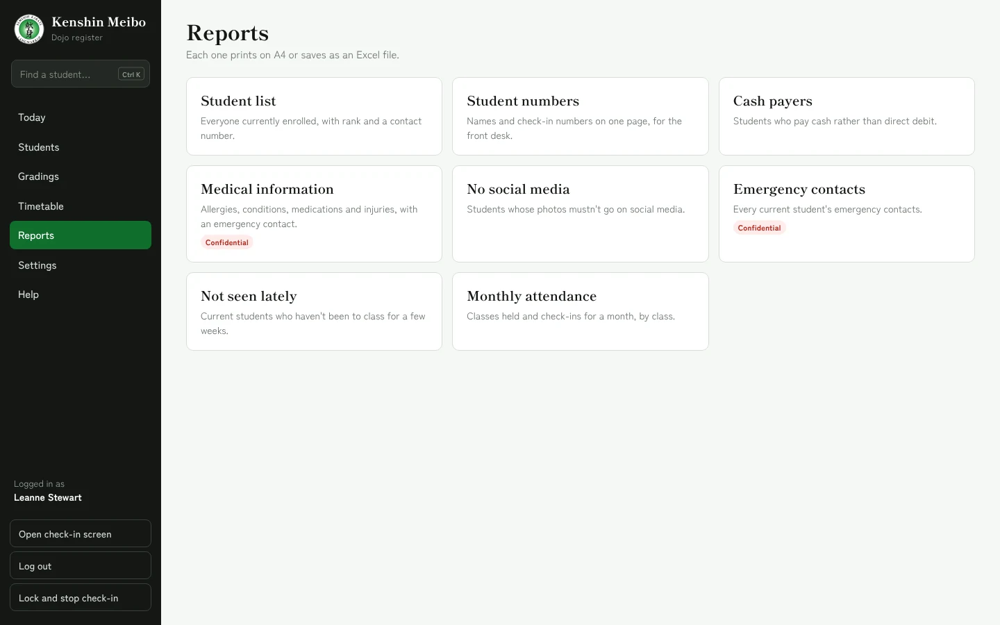

| Report | What's on it |
|---|---|
| **Student list** | Everyone enrolled, with rank and a contact number |
| **Student numbers** | Names and check-in numbers on one page, for the front desk |
| **Cash payers** | Students who pay cash rather than direct debit |
| **Medical information** | Allergies, conditions, medications and an emergency contact. Marked *Confidential*. |
| **No social media** | Students whose photos mustn't be posted, plus anyone not yet asked |
| **Emergency contacts** | Every current student's emergency contacts |
| **Not seen lately** | Current students who haven't been to class for a few weeks |
| **Monthly attendance** | Classes held and check-ins for a month, by class |

### On a report

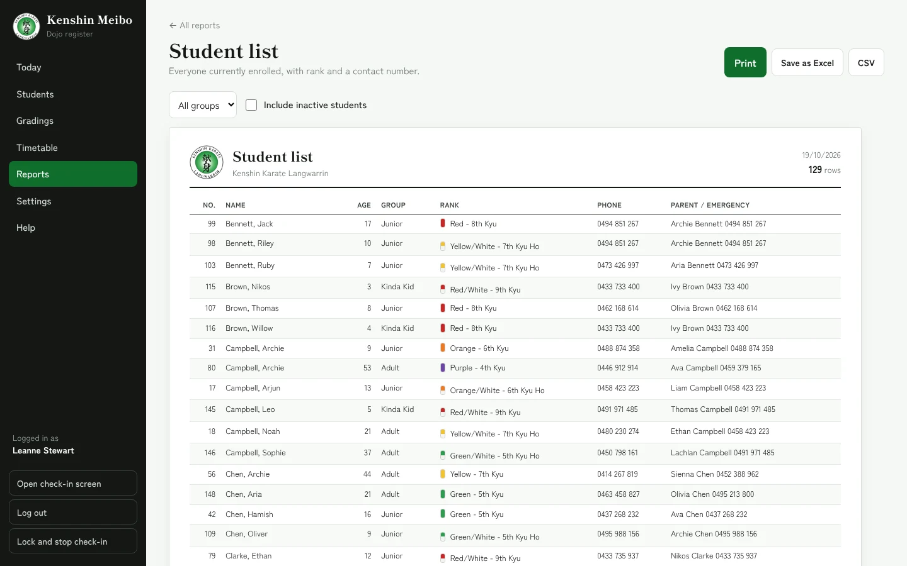

- Narrow it with the choices above it (group, month, include inactive students).
- **Sort it** by clicking a column heading, and click again to reverse. The arrow shows the order. **Student numbers** has **by name** and **by number** buttons instead.
- **Print**, **Save as Excel** and **CSV** all use the order you chose.
- **Print** prints it on A4. In the print window, choose your printer or **Save as PDF**.
- **Save as Excel** downloads it as a spreadsheet with the logo, title and date at the top.
- **CSV** is a plain list, for other programs.

Excel files are saved to your **Downloads** folder.

[↑ Contents](#contents)

---

## Settings

### Logins and passwords

Click **Settings**, then the **Logins** tab.

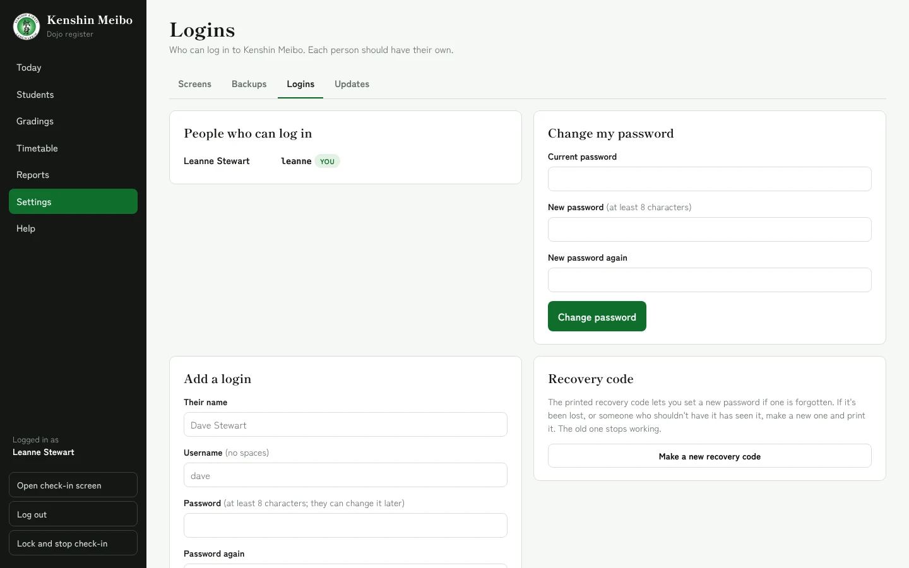

### Give someone their own login

Under **Add a login**, enter their name, a username (no spaces, for example *dave*) and a password of at least 8 characters, typed twice. Click **Add login**. They can use it straight away, and they should change the password to one only they know.

### Change your password

Under **Change my password**, enter your current password, then the new one twice. Click **Change password**.

### Remove a login

Click **Remove** next to their name. They can't log in any more, and nothing else is deleted. You can't remove your own login, so someone else has to.

### Recovery code

**Make a new recovery code** replaces the printed code. Do this if the printed one is lost or someone who shouldn't have it has seen it. The old one stops working, so print the new one. See [Forgotten password](#forgotten-password).

[↑ Contents](#contents)

### Forgotten password

In order of what to try:

1. **Someone else logs in.** If anyone else has a login, they can log in. Then you can change your password from **Settings → Logins** once you're in, or they can make you a new login.
2. **Use the recovery code.** On the login page, click **Forgotten password?**. Enter the printed recovery code, your username and a new password. You're logged in, and a **new recovery code** is shown, because the old one has now been used. Print the new one and put it where the old one was.
3. **Call Don.** If every password *and* the recovery code are lost, Don has a separate key, kept offline, that can unlock the data. Nothing is lost, but he'll need to do it.

Kenshin Meibo slows down after several wrong passwords in a row. That's on purpose, to stop guessing. Wait a moment and try again.

[↑ Contents](#contents)

### Backups

Kenshin Meibo backs itself up. The first time someone logs in, it asks where to keep the backups:

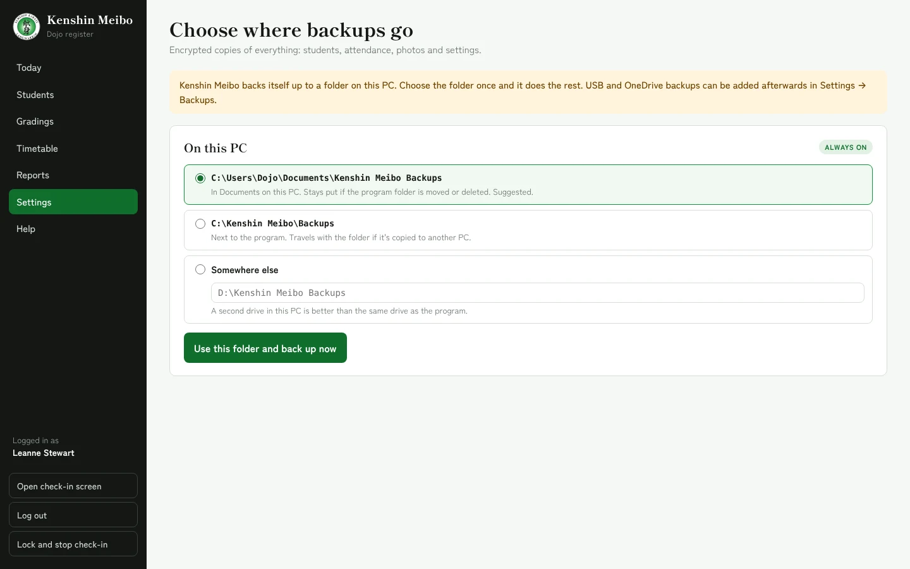

**Documents** is suggested. Click **Use this folder and back up now**, and you're done.

### Settings → Backups

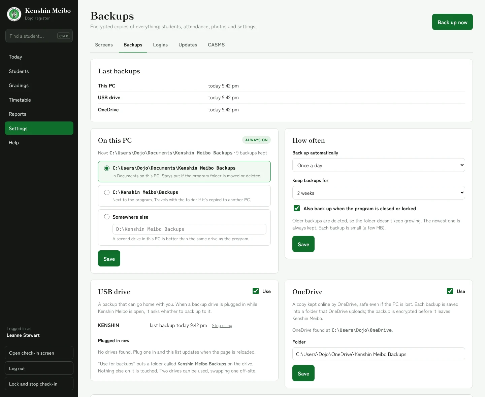

- **Last backups** shows when each place was last backed up.
- **On this PC** is always on. You can change the folder here.
- **How often**: once a day (the default), every 4 hours, or once a week. **Keep backups for** sets how far back you can go. It also backs up when the program is closed or locked, unless you untick that.
- **USB drive**: a copy that can go home with you. See [Back up to a USB stick](#back-up-to-a-usb-stick).
- **OneDrive**: a copy online, safe even if the PC is stolen or dies. Tick **Use**, check the folder, then click **Save**. OneDrive must be signed in on the PC: look for the cloud icon by the clock.
- **Back up now**, at the top, makes a backup straight away.

### What's kept

Backups are kept for **2 weeks** unless you change **Keep backups for** (1 week up to 1 year). Older ones are deleted, so the folder doesn't keep growing. The newest backup is always kept, however old. Each backup is small, a few MB.

### Are backups safe to leave lying around?

Yes. Each backup is a zip file holding the encrypted data. Without a password or the recovery code, it's unreadable, so a lost USB stick gives nothing away.

### Warnings

A bar at the top of the main screen tells you if:

- backups aren't set up yet
- the last backup didn't work, for example because the USB stick was pulled out or OneDrive is signed out
- there's been no backup for over a week

Click the button in the bar to fix it.

### Getting data back

**Restore from a backup**, at the bottom of this page, puts an earlier backup back. See [Get data back from a backup](#get-data-back-from-a-backup).

[↑ Contents](#contents)

### Back up to a USB stick

### Set up the stick (once)

1. Go to **Settings → Backups** and tick **Use** under **USB drive**.
2. Plug the stick in. It appears under **Plugged in now**. Click **Use for backups** next to it.

Or, with **Use** ticked, just plug in a new stick and Kenshin Meibo asks whether to use it.

This puts a folder called **Kenshin Meibo Backups** on the stick. Nothing else on it is touched. You can set up two sticks and keep one somewhere else.

### Each time after that

Plug the stick in while Kenshin Meibo is open. A bar appears at the top:

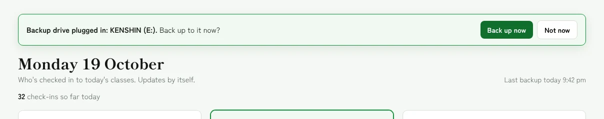

Click **Back up now**. A few seconds later it says **You can unplug the drive now**. Click **Not now** to skip it this time.

Other USB sticks, like a camera card, are ignored. Only sticks you've set up bring up the question.

[↑ Contents](#contents)

### Get data back from a backup

Use this if something has gone badly wrong, for example lots of students changed by mistake, and you want everything back the way it was on an earlier day.

### Restore from inside Kenshin Meibo

1. Go to **Settings → Backups**. At the bottom, **Restore from a backup** lists the most recent backups from this PC, OneDrive and any plugged-in backup stick, newest first.

   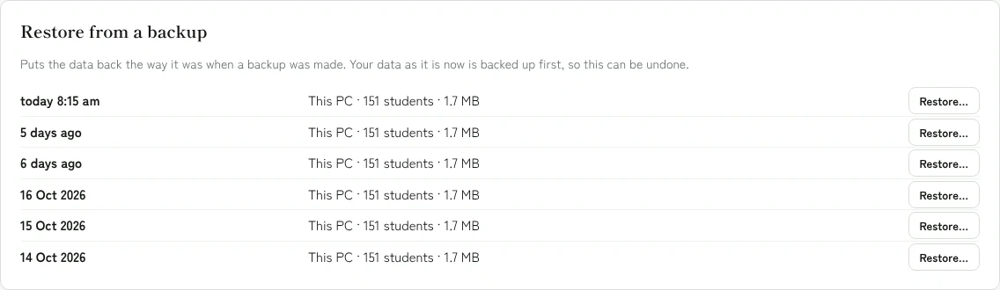

2. Click **Restore…** next to the one you want. To use a backup from somewhere else, click **Choose a backup file…** instead.
3. Check the date and number of students, then type a username and password **that worked when that backup was made**. If a password has been changed since, use the old one.

   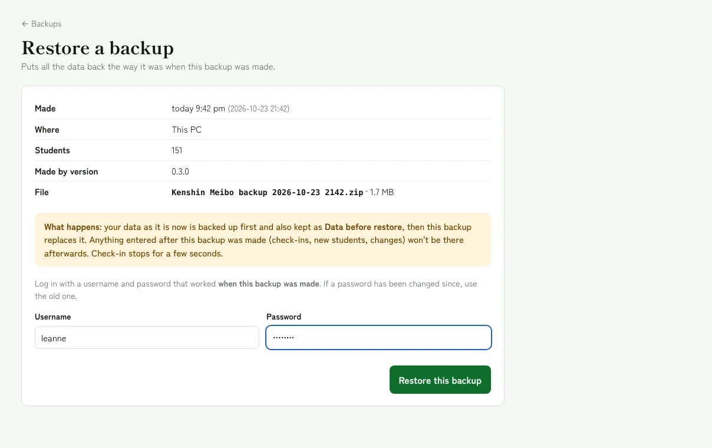

4. Click **Restore this backup**, then **OK**.

A few seconds later you're back on Today, logged in, with everything as it was when that backup was made. Anything entered after that, such as check-ins or new students, won't be there.

### Changed your mind?

Before restoring, Kenshin Meibo backs up your data as it was, so the newest backup in the list is the one from just before you restored. Restore that one to undo. It also keeps a copy in a folder called **Data before restore** inside the Kenshin Meibo folder, for Don to use if needed.

### On a new PC

If the old PC has died, choose **Bring back a Kenshin Meibo backup** when setting up on the new one. See [Moving to a new PC](#moving-to-a-new-pc).

[↑ Contents](#contents)

### Choose which screen does what

Kenshin Meibo asks this the first time. To change it later, go to **Settings → Screens**.

1. Click **Identify screens**. Each monitor shows a big number for a few seconds.
2. Choose the **Admin screen**, the one with the mouse and keyboard.
3. Choose the **Check-in screen**, the touch screen. Choose **Off** if there isn't one.
4. Click **Save and move windows**. The windows move straight away; the main window closes and reopens on its screen, still logged in.

If a monitor is unplugged, Kenshin Meibo uses what's there and goes back to your choice when it's plugged in again.

The windows open in Microsoft Edge, which is part of Windows. If Edge has been removed, they open in the normal web browser instead and can't be placed automatically.

[↑ Contents](#contents)

### Updates

Kenshin Meibo checks for a new version a minute after it starts, then every 6 hours. When there is one:

- a bar on the main screen says **Version … is ready to install**
- **Settings** in the menu shows an **Update** badge
- the [icon by the clock](#the-icon-by-the-clock) shows a message, and its menu gets an **Install update** item

### Installing

1. Go to **Settings → Updates**. It shows what's new in that version.
2. Pick a time between classes, then click **Install version …**, and **OK** to confirm.

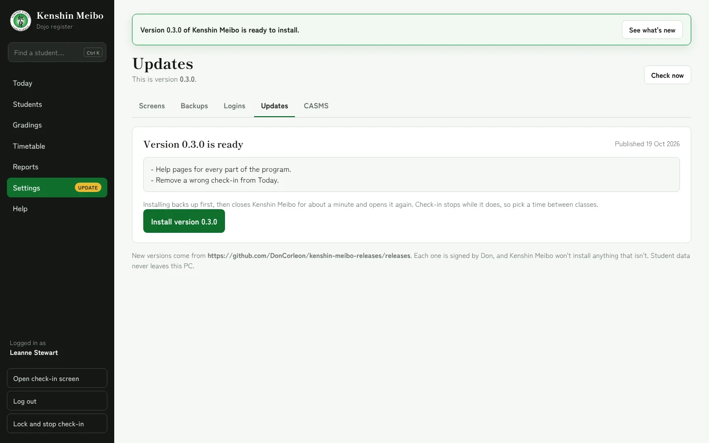

Kenshin Meibo then:

1. downloads the update and checks it really came from Don, refusing anything that doesn't match
2. backs up
3. closes for about a minute, swaps in the new version, and opens again by itself

Log in as usual afterwards.

If the new version doesn't start properly, the old one is put back automatically and it says so. Nothing is lost, but let Don know.

### Which version do I have?

It's at the top of **Settings → Updates**. Click **Check now** to look for a new version straight away.

[↑ Contents](#contents)

### Moving to a new PC

### If the old PC still works

1. On the old PC, right-click the [icon by the clock](#the-icon-by-the-clock) and choose **Quit Kenshin Meibo**.
2. Copy the whole **Kenshin Meibo** folder to a USB stick, then onto the new PC, for example to `C:\Kenshin Meibo`.
3. On the new PC, double-click **KenshinMeibo.exe** and log in with your usual password.
4. Check **Settings → Screens** and **Settings → Backups**. The new PC's monitors and folders may be different.

### If the old PC has died

1. On the new PC, [download and unzip Kenshin Meibo](#set-up-kenshin-meibo-on-a-pc), and start it.
2. On the setup screen, choose **Bring back a Kenshin Meibo backup**.
3. Click **Browse…** and pick the newest backup from the USB stick or OneDrive, in the **Kenshin Meibo Backups** folder.
4. Type a username and password that worked when that backup was made, then click **Bring back the backup**.

Everything comes back as it was when that backup was made.

Logins, passwords and the recovery code all move with the data. There's nothing to re-register.

[↑ Contents](#contents)

---

## Questions and answers

### Questions and answers

#### I closed the window. How do I get it back?
Click the Kenshin Meibo [icon by the clock](#the-icon-by-the-clock), or double-click Kenshin Meibo on the desktop again. Check-in kept working the whole time.

#### The touch screen says check-in is closed.
Someone needs to log in on the main screen. See [When check-in says no](#when-check-in-says-no).

#### A student checked into the wrong class.
Take them out with the **×** next to their name on Today. See [Fix a wrong check-in](#fix-a-wrong-check-in).

#### A student forgot to check in.
Add them at the desk from Today. See [Check someone in at the desk](#check-someone-in-at-the-desk).

#### How do I add a new student?
**Students → Add a student**. See [Add a new student](#add-a-new-student).

#### How do I remove a student who's left?
Untick **Currently enrolled**. Their history is kept in case they come back. See [When a student leaves](#when-a-student-leaves).

#### How do I update everyone's rank after a grading?
Use a grading sheet: one click per student. See [Grading day](#grading-day).

#### Brothers and sisters have to type their numbers separately.
Link them as a family, and then one number checks them all in. See [Families](#parents-emergency-contacts-and-families).

#### How do I close the dojo for the holidays?
**Timetable → Holidays and closures**. See [Holidays and closures](#holidays-and-closures).

#### How do I print the medical list?
**Reports → Medical information → Print**. See [Reports](#print-a-list-or-save-it-to-excel).

#### How do I give Dave his own login?
**Settings → Logins → Add a login**. See [Logins and passwords](#logins-and-passwords).

#### I've forgotten my password.
See [Forgotten password](#forgotten-password).

#### Is the student information safe?
Everything, including photos and medical details, is in one encrypted file that can't be read without a password. Backups are encrypted too. The touch screen only shows names and ranks. Nothing is sent over the internet, except for OneDrive backups if you turn them on, and those are encrypted first.

#### What if the PC dies?
Your backups have everything. Install Kenshin Meibo on another PC and choose **Bring back a Kenshin Meibo backup** when it starts. See [Moving to a new PC](#moving-to-a-new-pc).

#### Lots of things got changed by mistake. Can I go back?
Yes: **Settings → Backups → Restore from a backup**. See [Get data back from a backup](#get-data-back-from-a-backup).

#### Can it run on two computers at once?
No. One PC runs it, with a main screen and a touch screen. To move it, see [Moving to a new PC](#moving-to-a-new-pc).

#### Where's the old CASMS information?
All of it came across. Every student keeps their number, and each student's **Original record** tab shows what CASMS had. See [Attendance and history](#attendance-and-history).

#### Something's not working.
Right-click the icon by the clock, choose **Open the program folder**, and send Don the files in the **Logs** folder. They record what the program did, not student details.

[↑ Contents](#contents)

---

Kenshin Meibo is made by Don for Kenshin Karate Langwarrin. Builds on this page are signed; the program won't install an update that isn't.
